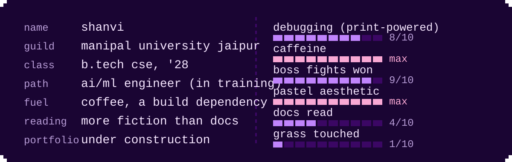

<!-- ================================================================== -->
<!--  SHANVI — PIXEL / COFFEE / CODE GITHUB README                      -->
<!--  all art lives in /assets as hand-built, animated SVGs             -->
<!-- ================================================================== -->

<div align="center">



<br/>

<a href="https://www.linkedin.com/in/shanvi-kumari-6786a12a2/"></a>
<a href="https://github.com/shanvi98?tab=repositories"></a>


</div>


## `>_` about me



<details>
<summary><sub>plain-text version</sub></summary>

- 🎓 B.Tech CSE @ **Manipal University Jaipur**, Class of 2028
- 🤖 building my way into an **AI/ML engineer** — one model, one bug, one coffee at a time
- 🎮 probably one boss fight away from touching grass
- ☕ coffee is not a beverage, it's a build dependency
- 📚 reading more fiction than documentation lately (don't tell my professors)
- 🌸 soft aesthetic, sharp debugging skills — pastel outside, `print()` statements inside
- 🌐 portfolio: under construction

</details>


## `>_` quest log



<details>
<summary><sub>plain-text version</sub></summary>

```
[✓] Internship Copilot Agent — FastAPI + LLM resume matcher
[✓] HoopSense AI — CV/ML basketball shot analyzer
[✓] this readme (unreasonably aesthetic, zero regrets)
[ ] land an ML/AI internship
[ ] clear backlog of games AND books (unlikely, but we manifest)
[ ] world domination (soft launch)
```

</details>


## `>_` featured builds

<table>
<tr>
<td width="50%"><a href="https://github.com/shanvi98/semantic-reconcillation-engine"></a></td>
<td width="50%"><a href="https://github.com/shanvi98/hybridrag"></a></td>
</tr>
<tr>
<td width="50%"><a href="https://github.com/shanvi98/Aeropulse-pipeline"></a></td>
<td width="50%"><a href="https://github.com/shanvi98/vireo_cx_tool1"></a></td>
</tr>
<tr>
<td width="50%"><a href="https://github.com/shanvi98/internship-copilot"></a></td>
<td width="50%"><a href="https://github.com/shanvi98/SIH"></a></td>
</tr>
</table>


## `>_` tech stack

<div align="center">

**// LANGUAGES //**


**// AI / ML //**


**// DEV TOOLS //**


**// FRONTEND //**


</div>


## `>_` live stats

<div align="center">


<br/>

[](https://github.com/shanvi98/github-readme-stats-fast)

### `>_` contribution snake


</div>


## `>_` snapshots

<p align="center"><i>a tiny gallery — bits and pieces 🤍</i></p>

<div align="center">
<table>
<tr>
<td align="center" width="33%"></td>
<td align="center" width="33%"></td>
<td align="center" width="33%"></td>
</tr>
<tr>
<td align="center" width="33%"></td>
<td align="center" width="33%"></td>
<td align="center" width="33%"></td>
</tr>
</table>
</div>


